# GNSS 欺骗检测测试报告：同一批 DS2 与 DS3 实测数据

同一批 TEXBAT 实测数据，复现五种 GNSS 欺骗检测方法。正文给出检测量、门限、逐星结果和异常原因分析。

**直接看结果**：[数据与读图](#数据与读图) · **下载与运行**：[运行与复现](#运行与复现)


## 导读

本项目用 DS2 和 DS3 复现了五种常见的欺骗检测思路：有的看相关峰形状或跟踪点附近的正交响应，有的看接收机输入的功率和电平分布，还有的看伪距变化是否平稳。实际运行时以统计量和门限作判决，有多星判决规则的方法还要合并各星的越阈结果。下文的同相（I）和正交（Q）俯视图用于解释这些统计量为何升高或回落。

**各方法看什么，需要什么资源**

| 方法 | 检测量描述的特征 | 主要资源开销（按本次复现配置） |
|---|---|---|
| Sun | 跟踪点两侧的 Q 幅度，相对于中心 I 的大小 | 每星每 1 ms 读取两个 Q 值和一个 I 值，维护 5 秒滑动平均；若点位匹配，可复用现有跟踪相关器。 |
| Shang | 实测复相关曲线偏离理想单峰的程度 | 每星每 1 ms 计算 81 个复相关值，减去模板后再校正各点噪声的相关性；主要开销是密集相关和矩阵运算。 |
| Deng | 中心附近四个 Q 值相加后，在 4 秒内的能量 | 每星每 1 ms 读取四个 Q 值，维护 4 秒滑动能量；需要相应的相关器点位，多星合判还需要多个有效通道。 |
| Feng | 伪距变化速度的波动。伪距是接收机用信号传播时间换算的距离观测。 | 已有伪距输出时，额外计算量较小：每星每 0.5 秒做一次差分，累积最近 40 项，约 20 秒。 |
| Bhuiyan | 捕获前的输入电平分布是否偏离参考 | 需要读前端原始采样；本次每秒取一个 100 ms 窗，将约 250 万个 I 样本计入 64 个电平分箱。整个接收机共用一个检测量。 |

这里列的是实时计算所需的输入、处理量和窗口长度。实际算力和功耗还取决于硬件能否复用已有相关器，以及能否在前端就地统计采样电平。

**哪些场景容易检出，哪些容易漏报或误报**

| 方法 | 适用场景 | 容易失效或误报的情况 |
|---|---|---|
| Sun | 跟踪连续，两路信号叠加使早、迟点的 Q 投影明显增大。 | Q 投影弱或真实峰已离开取样点时，响应可能减弱；中心 I 瞬间接近零则可能把检测量大幅抬高。 |
| Shang | 牵引使峰肩变形，或观测范围内出现旁峰。 | 两路叠加后仍接近单峰时不易检出；多径和跟踪偏差也会让实测峰偏离模板。 |
| Deng | 中心附近的 Q 异常能维持一段时间，且有足够多的有效通道做合判。 | 四个 Q 值正负相抵，或异常移出取样区时，响应可能减弱；多星共同告警还取决于同一时刻有多少颗星越阈。 |
| Feng | 已有连续伪距，牵引起步、变速或引起跟踪跳动。 | 近似匀速拉偏时，伪距仍可持续偏移而检测量较低；伪距中断时，需重新积满连续窗口。 |
| Bhuiyan | 欺骗使前端输入功率或电平分布明显变化，接收机尚未捕获也可监测。 | 输入分布接近参考时不易检出；压制干扰或前端增益变化也可能触发同样的告警。 |

原论文展示的效果都有其试验条件。两段录制的复现中，有的卫星只间歇越阈，有的在牵引仍在继续时已经回落。实际环境比这里的静态授时牵引更复杂：攻击可能贴着真实信号慢慢拉走跟踪点，也可能先用干扰让接收机失锁，再趁重新捕获时让它锁上假信号。[Rothmaier 等](https://onlinelibrary.wiley.com/doi/full/10.1002/navi.420)讨论了这两类过程对检测的影响。工程上要根据载体运动、使用环境、可用算力和功耗，以及允许的告警延迟与误报来选择检测手段。有些攻击很容易看出异常，更难的是告警后如何压制干扰或隔离受骗观测，并在重新确认信号可信前，维持可用的定位或授时。

## 数据与读图

使用 [TEXBAT](https://radionavlab.ae.utexas.edu/texbat/) 的 DS2 和 DS3。按[场景说明](https://radionavlab.ae.utexas.edu/images/stories/files/papers/tbION_for_distribution.pdf#page=7)，两段都是静态授时牵引；DS2 的欺骗信号功率较强，DS3 则与真实信号接近。两段均为 GPS L1 C/A、25 MS/s、零中频、16 位有符号同相（I）与正交（Q）交织采样。

| 录制 | 固定星表（PRN 为卫星的伪随机码编号） | 展示区间 |
|---|---|---|
| DS2 | 13、23、30、32 | 95–240 s |
| DS3 | 7、13、19、30 | 95–240 s |

同一录制、同一颗星的各方法共用相同 I/Q 热图。Bhuiyan 从捕获前的原始采样每秒取一个 100 ms 窗，每段录制只有一条检测曲线；其图下方列出该录制的同四颗星。所有门限标定和检测曲线均不按载噪比或相位质量筛选。积分不完整、公式无定义或窗口未积满时留空。

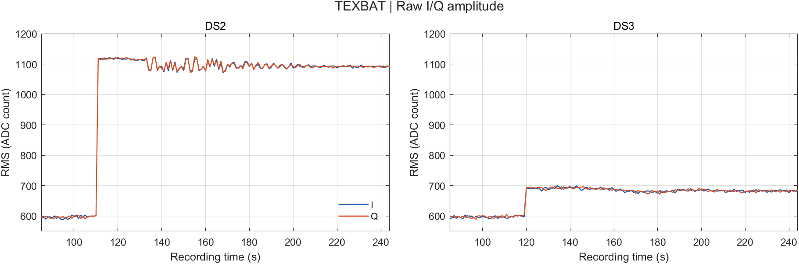

**图 1｜原始 I/Q 采样幅度。** 每秒取首个 20 ms 窗，绘制 I、Q 的均方根，单位为 ADC（模数转换器）计数。DS2 约 111 s 的抬升比 DS3 约 120 s 的抬升明显。

**怎么读三联图。** 上方红线是检测量，灰虚线是本方法的门限。下方 I/Q 俯视图用于事后解释统计量的变化。黑点线是接收机正在跟踪的准时相关点（Prompt），纵轴是相对它的码延迟。在 ±2 码片内每隔 0.05 码片放一个相关器，共 81 点。每秒用最近 20 个连续完整的 1 ms 积分，按接收机当时的本地载波和码相位求相关；I、Q 的平均功率分别用该窗的输入功率归一化，色标以分贝（dB）显示。欺骗信号接管后，零线跟着欺骗峰走；真实峰便相对零线退开。

**遇到大尖峰怎么看。** 主图的纵轴保留能看清平常波动和门限的范围。橙色点标出超过这个范围的时刻；点的位置只表示时间。对应详图保留这些时刻的完整幅度，下面两行仍与同一时段的 I/Q 对齐。

## 第 1 章　Sun：Q 支路两点检测（Q-SQM）

### 1.1 检测量

[Sun 等](https://doi.org/10.1109/TIM.2021.3102753) 的 Q-SQM 是基于 Q 支路的信号质量监测量。欺骗接管后，本地载波逐渐对准欺骗信号，真实信号的载波相位与之不同，于是可在 Q 支路留下投影。真实峰退开时，固定早、迟两点读到的幅度也会变。

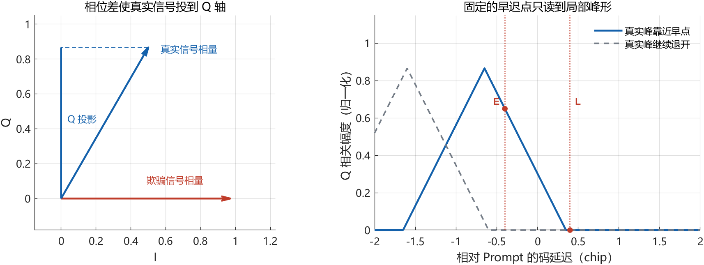

**图 2｜Q 投影与两点读数。** 左图用理想相量示意 Q 投影。右图的 E、L 分别是固定早、迟点；当真实峰继续向左退开，早点读数降低，检测量可以回落。

令 $`n`$ 为 1 ms 跟踪历元的编号。$`Q_{E,n}`$ 和 $`Q_{L,n}`$ 分别是早、迟两点的 Q 相关值，两点距 Prompt 均为 0.4 chip；$`I_{P,n}`$ 是 Prompt 的 I 相关值。单历元检测量 $`q_n`$ 用 $`|I_{P,n}|`$ 对两点的合成幅度归一化；取绝对值可适应导航数据位翻转。$`\bar q_n`$ 是最近 $`w=5000`$ 个连续且可计算的历元的平均值，$`\ell`$ 为窗口内向过去数的历元偏移。分母接近零时保留有限的比值；分母为零时该项无定义。

```math
q_n=\frac{\sqrt{Q_{E,n}^{2}+Q_{L,n}^{2}}}{|I_{P,n}|},
\qquad
\bar q_n=\frac{1}{w}\sum_{\ell=0}^{w-1}q_{n-\ell}.
```

### 1.2 门限怎么算

对每颗星，先在 TEXBAT 配对的无欺骗参考录制（cleanStatic）上用同样的 5 s 窗计算 $`\bar q_n`$。取窗结束时刻 $`t_n`$ 落在该录制 $`[5,20)`$ s 内的有效结果，记为标定样本序列 $`\mathcal B`$。$`\widehat Q_{0.99}`$ 表示用 MATLAB 的 quantile 函数取经验第 99 百分位（概率参数 0.99）。图中的逐星门限 $`\gamma_\mathrm{emp}`$ 为

```math
\mathcal B=\bigl(\bar q_n\bigr)_{5\ \mathrm{s}\le t_n<20\ \mathrm{s},\ \text{窗口有效}},
\qquad
\gamma_\mathrm{emp}=\widehat Q_{0.99}(\mathcal B).
```

标定使用实际完成的连续积分。每颗星有 15,000 个标定窗，PRN 32 有 14,999 个。DS2 与 DS3 中的同一颗星共用门限。运行时以 $`\bar q_n>\gamma_\mathrm{emp}`$ 为单星越阈。实测门限如下，数值已舍入。

| 录制 | PRN | 逐星门限 |
|---|---:|---:|
| DS2 | 13 | 0.086542 |
| DS2 | 23 | 0.088744 |
| DS2 | 30 | 0.273476 |
| DS2 | 32 | 0.475760 |
| DS3 | 7 | 0.123680 |
| DS3 | 13 | 0.086542 |
| DS3 | 19 | 0.127360 |
| DS3 | 30 | 0.273476 |

**原文公式修正。** 若两个归一化 Q 分量近似为独立同方差的零均值高斯，$`q_n`$ 近似服从尺度参数为 $`\sigma`$ 的瑞利分布。原文式 (22) 定义窗口均值，式 (23) 却将单历元方差乘以 $`w`$。历元独立时，均值方差应除以 $`w`$。设 $`p`$ 为名义上尾概率，$`\mathrm{erfc}^{-1}`$ 为互补误差函数的反函数，则均值的方差 $`\mathrm{Var}(\bar q_n)`$ 和修正后的高斯近似门限 $`\gamma_\mathrm{IID}`$ 为

```math
\mathrm{Var}(\bar q_n)=\frac{(4-\pi)\sigma^2}{2w},
\qquad
\gamma_\mathrm{IID}
=\sigma\sqrt{\frac{\pi}{2}}
+\sigma\sqrt{\frac{4-\pi}{w}}\mathrm{erfc}^{-1}(2p).
```

### 1.3 实测结果：Q 变亮，还是中心 I 变弱？

| 录制 | 同一星表的三联图 |
|---|---|
| DS2 | [PRN 13](figures/sun_ds2_prn13.png) · [PRN 23](figures/sun_ds2_prn23.png) · [PRN 30](figures/sun_ds2_prn30.png) · [PRN 32](figures/sun_ds2_prn32.png) |
| DS3 | [PRN 7](figures/sun_ds3_prn07.png) · [PRN 13](figures/sun_ds3_prn13.png) · [PRN 19](figures/sun_ds3_prn19.png) · [PRN 30](figures/sun_ds3_prn30.png) |

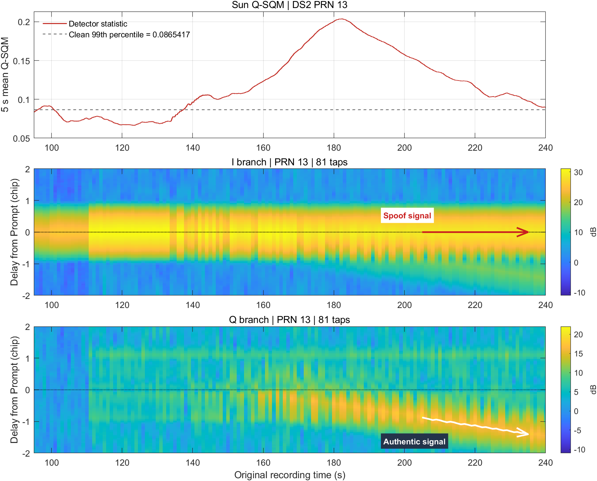

**图 3｜DS2 PRN 13。** 红箭头标出留在跟踪中心的欺骗峰，白箭头标出向负延迟退开的真实峰，标注参照配对无欺骗录制。约 182 s，检测量开始回落，真实峰仍继续远离中心。峰离开早、迟两个观察点，两个点读到的 Q 就会减弱。

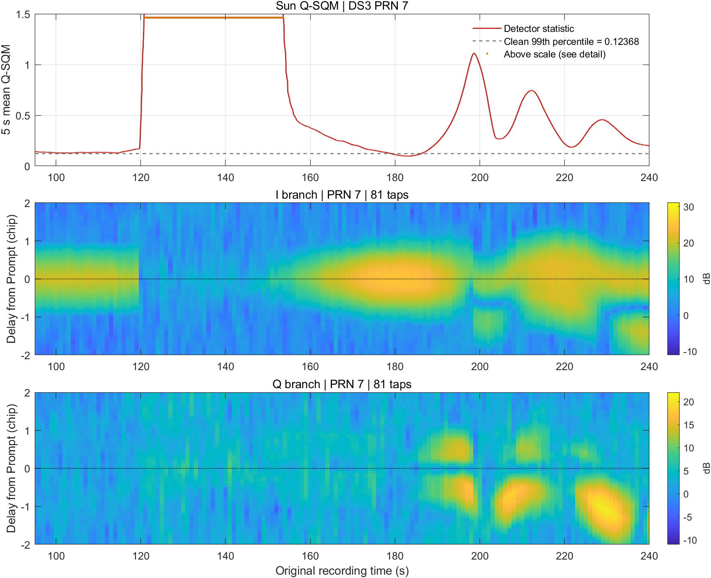

**图 4｜DS3 PRN 7（主图）。** 约 120 s，原本在中心的 I 亮带突然变暗。主图用 0–1.5 的纵轴保留门限和其他时段的起伏。[115–160 s 全幅详图](figures/detail_sun_ds3_prn07.png)能看清橙色标记内的两层变化：弱峰时比值先升到约 6–8，132–137 s 又叠加一段约 30 的高台。公式用中心 I 作分母，I 变小本身就会抬高比值。

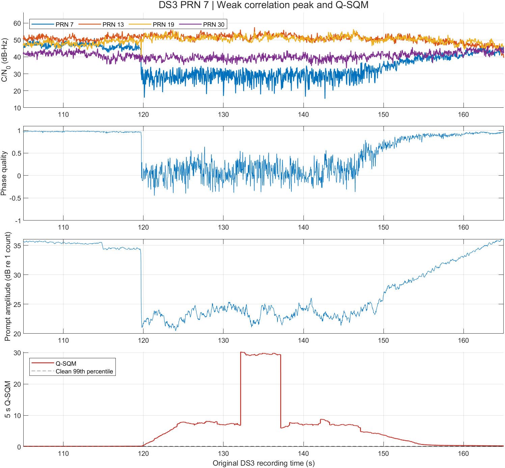

**图 5｜把弱峰和高台分开看。** 上两行是四颗星的载噪比（图中记为 $`C/N_0`$）和 PRN 7 的相位质量；第三行是中心复相关幅度的 200 ms 滑动中位数，末行是 Q-SQM。相位质量用 I、Q 的功率之差除以功率之和：接近 1 时能量集中在 I，接近零时两边相近。

**为什么峰变弱？** 约 120 s，PRN 7 的相关峰变弱。即使绕开跟踪点，直接从原始数据里找最高峰，它与背景的功率差也从约 15–17 dB 缩到 5–6 dB。这与两路信号相消的情形相符：真实信号和欺骗信号差不多强、到达时间又接近，如果一个波峰刚好对上另一个波谷，叠在一起就会抵掉大半。[TEXBAT 场景 3](https://radionavlab.ae.utexas.edu/images/stories/files/papers/tbION_for_distribution.pdf#page=9)记录了这种现象。

**峰弱了，检测量为什么反而升高？** Q-SQM 用两侧 Q 的合成幅度除以中心 I 的绝对值。弱峰阶段，分子增大约六成，分母却降到原来的约七分之一。两者都推高了检测量，其中分母的变化更大。图上的载噪比下降也是峰变弱的一条线索。

**为什么会高五秒？** 在 132.148 s 那一毫秒，中心 I 几乎为零，两侧 Q 却没有特别大。这个极小的分母让单点比值猛增：五秒均值最高达到 30.23，其中 23.42 就来自这一点。只要它还在平均窗口内，曲线就会维持高位；约五秒后它滑出窗口，曲线随即回落。DS2 PRN 32 和 DS3 PRN 30 也有类似台阶。

**判断。** Q-SQM 反映跟踪点附近的 I、Q 变化。统计量越阈，既可能是欺骗信号介入后两侧的 Q 投影增大，也可能是中心 I 变小把比值抬高，两种变化也可能同时发生。实际运行时以统计量越阈作为异常告警；复现中的 I/Q 俯视图用于事后解释统计量为什么升高或回落。

八组结果中，Q-SQM 对早、迟两个取样点附近的 Q 异常更敏感。若中心 I 没有明显减小，两侧 Q 投影较弱时，统计量可能升得不明显；真实峰远离两个取样点后，统计量也可能在牵引仍在继续时回落。DS2 PRN 13 的真实峰继续远离跟踪点，统计量却逐渐回落；DS2 PRN 32 的 Q 图中没有清晰的分离峰，后段统计量也大多低于门限。

## 第 2 章　Shang：多相关器的整峰残差

### 2.1 检测量

[Shang 等](https://link.springer.com/article/10.1007/s10291-023-01438-0) 在 Prompt 两侧 ±2 chip 取 81 个复相关点。先用 Prompt 调整理想单峰的幅度和相位，再与实测曲线相减。峰肩和旁峰会留在残差里。

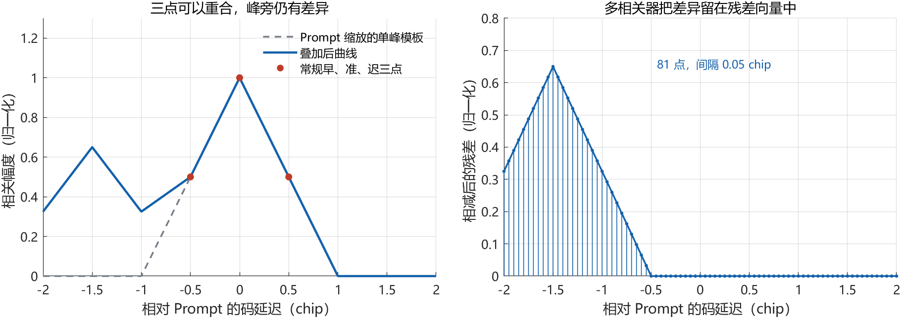

**图 6｜整峰残差示意。** 加入一个向左偏移 1.5 chip 的同相分量后，早、准、迟三点仍与理想峰重合；右图的多相关器仍能读到左侧残差。图中使用理想三角峰。

令 $`\mathbf{U}`$ 为一个 1 ms 历元的 81 点复相关向量，每点的相关和已除以积分样本数；$`U_0`$ 是其中的 Prompt 值。令 $`i,j`$ 为相关器编号，$`d_i,d_j`$ 为两相关器相对 Prompt 的码延迟，单位为码片。噪声相关矩阵 $`\mathbf{R}`$ 的元素为 $`R_{ij}=\max(0,1-|d_i-d_j|)`$；其中心列 $`\mathbf{h}`$ 就是中心值为 1 的理想三角峰，第 $`i`$ 项为 $`h_i=\max(0,1-|d_i|)`$。记 $`\mathbf{r}`$ 为去掉单峰模板后的残差，上标 $`H`$ 为共轭转置。白化残差能量 $`e`$ 经每个实分量的噪声方差估计值 $`\hat\sigma^2`$ 归一化，得到检测量 $`T`$。

```math
\mathbf{r}=\mathbf{U}-\mathbf{h} U_0,\qquad
e=\mathbf{r}^H\mathbf{R}^{-1}\mathbf{r},\qquad
T=e/\hat\sigma^2.
```

### 2.2 门限怎么算

先估计噪声方差，再对归一化检测量设门限。每段录制的每颗星在 $`[86,95)`$ s 内每 0.1 s 取最近一个已完成的 1 ms 标定帧，取 90 帧，记帧数为 $`K=90`$。令 $`e_b`$ 为第 $`b`$ 个标定帧的白化残差能量，$`b`$ 从 1 到 $`K`$。无欺骗模型下，中心点投影使 I、Q 各剩 80 个自由度，合计 $`\nu=160`$；因此用平均残差能量除以 $`\nu`$ 来估计噪声方差，随后冻结。

```math
\hat\sigma^2=\frac{1}{K\nu}\sum_{b=1}^{K}e_b.
```

设 $`p=10^{-4}`$ 为名义上尾概率，$`\chi^2_{\nu,1-p}`$ 表示自由度为 $`\nu`$ 的卡方分布的第 $`1-p`$ 分位点。令卡方上尾在门限 $`\gamma`$ 处等于 $`p`$，得到

```math
\gamma=\chi^2_{160,\,0.9999}\approx235.22068,\qquad T>\gamma\ \text{时越阈}.
```

**原文公式修正。** 式 (27) 给出 81 个自由度。按式 (7) 的复噪声和每个实分量的方差约定，中心点投影后应使用 160 个自由度。实测图使用起始段估计并冻结的方差，因此图线是名义门限。

### 2.3 实测结果：一个标准峰还能不能解释实测曲线？

| 录制 | 同一星表的三联图 |
|---|---|
| DS2 | [PRN 13](figures/shang_ds2_prn13.png) · [PRN 23](figures/shang_ds2_prn23.png) · [PRN 30](figures/shang_ds2_prn30.png) · [PRN 32](figures/shang_ds2_prn32.png) |
| DS3 | [PRN 7](figures/shang_ds3_prn07.png) · [PRN 13](figures/shang_ds3_prn13.png) · [PRN 19](figures/shang_ds3_prn19.png) · [PRN 30](figures/shang_ds3_prn30.png) |

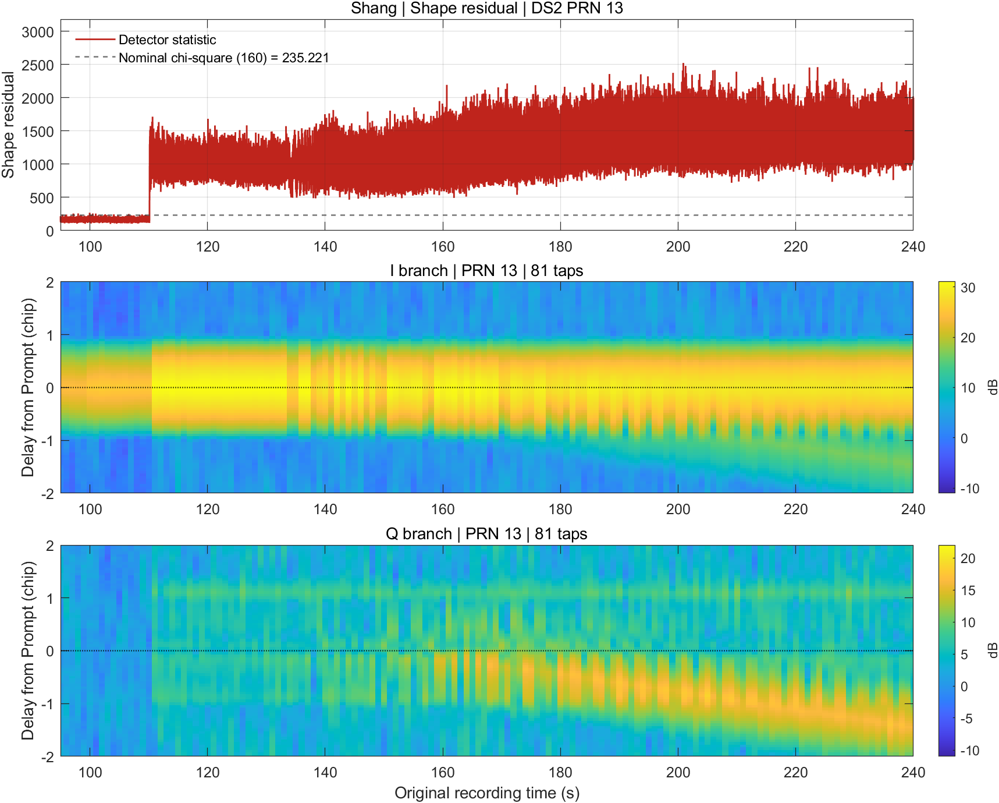

**图 7｜DS2 PRN 13。** 约 111 s，检测量随输入抬升而跳高，相关图此时还没有明显的第二峰。随后中心峰旁出现拖尾，第二条峰迹向外退开，检测量仍高。单个三角峰与中心对齐后，峰肩和第二峰都会留在它与实测曲线的差里。

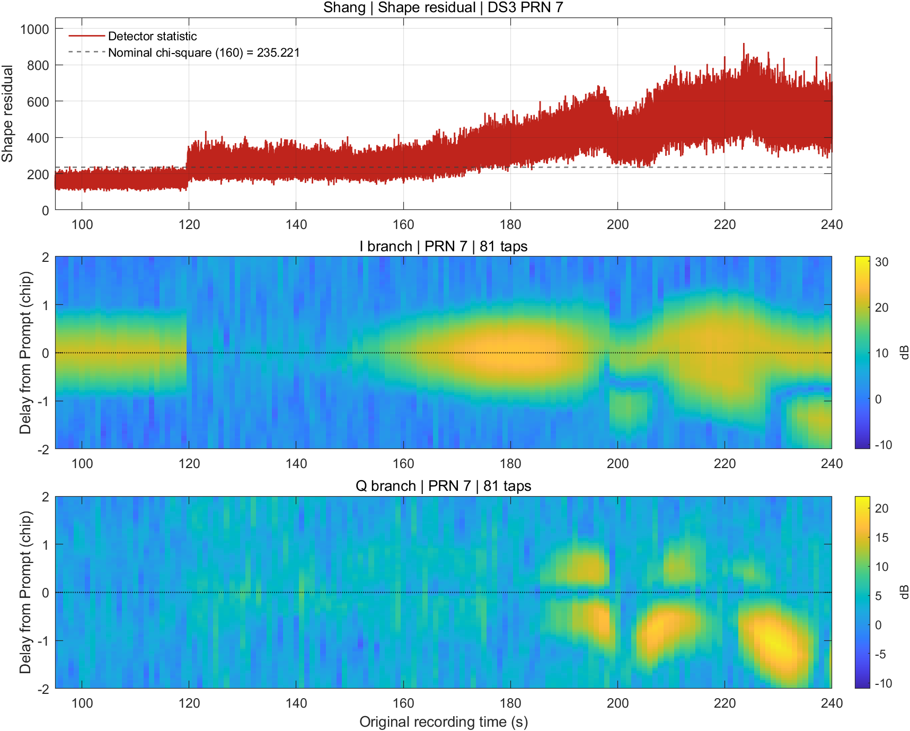

**图 8｜DS3 PRN 7。** 中心亮带变暗时，检测量中位数却从约 160（110–115 s）升到 240（120–130 s），达到门限 235 附近。把 105 s 和 125 s 前各 20 ms 的复相关曲线分别与单峰模板相减，I 和 Q 两边的残差都增大。变化出在整条曲线与模板的差距；此时还看不见两个独立的峰。

**判断。** Shang 的越阈提示：**实测相关曲线已明显偏离理想单峰。** 欺骗叠加可以改变峰肩或产生旁峰，多径和跟踪偏差也会造成类似的峰形失配。多相关器能发现肉眼还看不出第二个峰时的异常，例如 DS2 PRN 13 在两峰明显分开前已经越阈。

如果叠加后的曲线仍接近单峰，检测量的升幅就可能较小。DS3 PRN 30 在约 120 s 出现响应，但随后一段时间仍在门限上下波动。能否持续越阈，取决于观测范围内的峰形与模板相差多大。

## 第 3 章　Deng：四点 Q 相关和的窗口能量

### 3.1 检测量

[Deng 等](https://doi.org/10.1109/JSEN.2024.3481455) 先把 Prompt 两侧 ±0.25、±0.5 chip 的四个 Q 值相加，再看这四点合成的异常能量是否持续。令 $`n`$ 为 1 ms 历元编号，$`\mathbf{q}_n`$ 为该历元的四点 Q 向量，每个相关和都已除以积分样本数。令 $`\mathbf{1}`$ 为四项均为 1 的列向量，上标 $`T`$ 为转置。$`u_n`$ 是四点之和，$`\hat s^2`$ 是其起始段方差估计。检测量 $`D_n`$ 累积最近 $`m=4000`$ 个连续有效历元的归一化能量，$`\ell`$ 为向过去数的历元偏移。

```math
u_n=\mathbf{1}^T\mathbf{q}_n,\qquad
D_n=\frac{1}{\hat s^2}\sum_{\ell=0}^{m-1}u_{n-\ell}^2.
```

### 3.2 门限怎么算

每颗星从各自录制的 90 s 起取首 $`K=4000`$ 个连续标定历元，覆盖约 90–94 s。令 $`u_b`$ 为第 $`b`$ 个标定历元的四点和，$`\bar u`$ 为这 $`K`$ 个和的均值。直接对四点和计算方差，相当于保留四个相关器之间的协方差。运行时直接平方累加四点和，只用这项方差归一化。

```math
\hat s^2=\frac{1}{K}\sum_{b=1}^{K}(u_b-\bar u)^2.
```

若无欺骗时的四点和为零均值高斯、各历元独立且方差已知，$`D_n`$ 服从 $`m`$ 自由度的中心卡方分布。取名义上尾概率 $`p=0.01`$，以 $`\chi^2_{m,1-p}`$ 表示该分布的第 $`1-p`$ 分位点。图中门限 $`\gamma`$ 为

```math
\gamma=\chi^2_{4000,\,0.99}\approx4211.01142,\qquad D_n>\gamma\ \text{时越阈}.
```

图中展示单星结果；原文在至少四颗星同刻越阈时给出共同告警。

**原文公式修正。** 式 (14) 将四点的边缘方差相加，漏掉协方差；这里直接用四点和的方差。式 (22) 的互补误差函数反演少了系数 2。用 $`\mathrm{erfc}^{-1}`$ 表示互补误差函数的反函数，修正后的正态近似门限为 $`m+\sqrt{4m}\mathrm{erfc}^{-1}(2p)`$。实测图使用卡方分位点，归一化方差由起始段估计。

### 3.3 实测结果：中心附近的 Q 是否持续有反应？

| 录制 | 同一星表的三联图 |
|---|---|
| DS2 | [PRN 13](figures/deng_ds2_prn13.png) · [PRN 23](figures/deng_ds2_prn23.png) · [PRN 30](figures/deng_ds2_prn30.png) · [PRN 32](figures/deng_ds2_prn32.png) |
| DS3 | [PRN 7](figures/deng_ds3_prn07.png) · [PRN 13](figures/deng_ds3_prn13.png) · [PRN 19](figures/deng_ds3_prn19.png) · [PRN 30](figures/deng_ds3_prn30.png) |

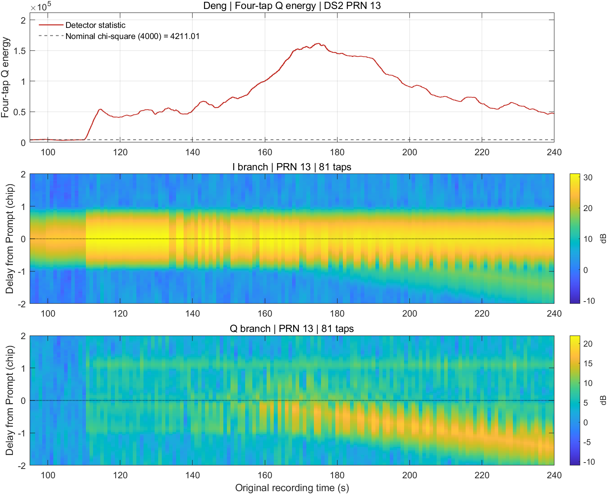

**图 9｜DS2 PRN 13。** 从 170–190 s 到 220–240 s，检测量回落但仍在门限上方。此时 Q 亮带已退到半个码片以外。图上仍然看得见它；固定在中心附近的四个点，只能看到它留在中心附近的部分。

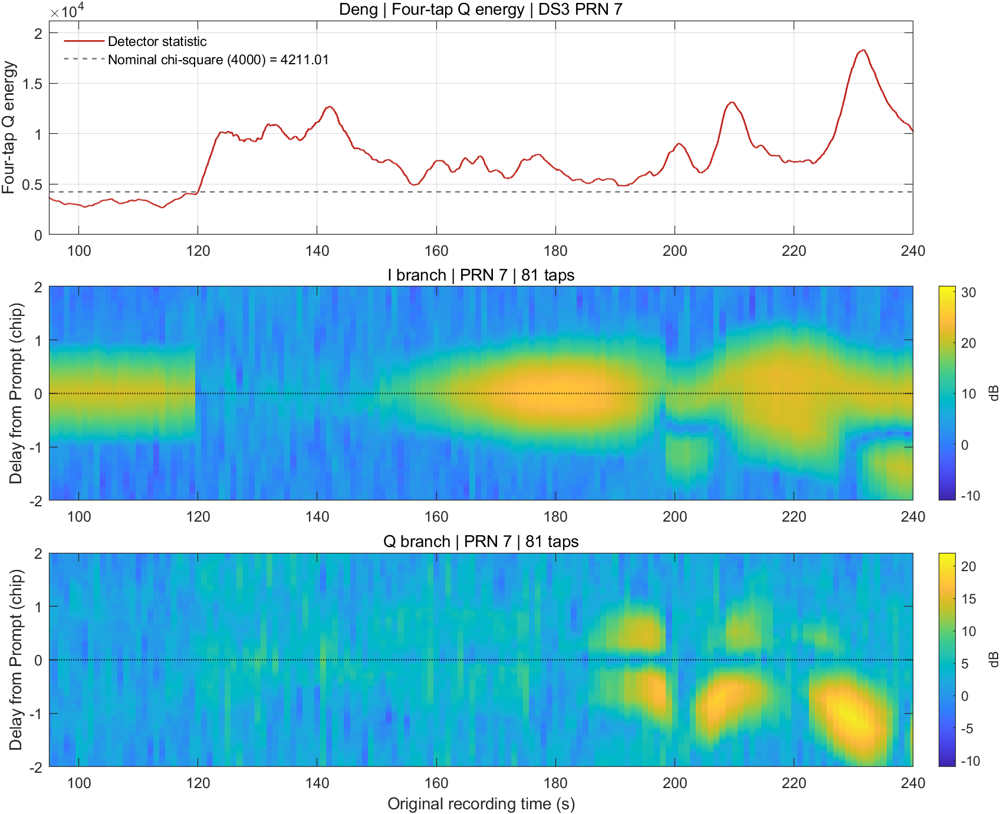

**图 10｜DS3 PRN 7。** 110–115 s 的检测量中位数约 3034，弱峰阶段（120–130 s）升到约 9400，高于门限 4211。取 125 s 前的 20 ms 逐毫秒查看，四点相加后的读数围绕零上下波动，能量主要来自波动。Deng 把正、负波动都平方，再累加 4 秒，弱峰期间也能出现高值。

**判断。** Deng 的单星越阈提示：**过去 4 秒内，跟踪点附近四个 Q 读数相加后的能量偏高。** 四点和可以持续偏大，也可以围绕零剧烈波动；DS3 PRN 7 弱峰阶段的高值主要来自后者。实际应用中，原文还要求至少四颗星同时越阈才给出共同告警。

四个 Q 读数先相加再平方。正负相抵时，各点即使各自变化明显，合在一起也可能读得很小；Q 峰远离取样位置，响应也会减弱。DS2 PRN 13 后段就出现了回落，但这一组仍在门限之上。

## 第 4 章　Feng：伪距二阶差分（CD²-P）

### 4.1 检测量

[Feng 等](https://doi.org/10.1109/JIOT.2024.3461228) 从伪距观察距离变化率是否持续改变。令 $`n`$ 为伪距历元编号，$`\rho_n`$ 为该历元的伪距（m），$`\Delta t=0.5`$ s 为历元间隔，$`F_n`$ 为卫星几何距离和卫星钟的已知二阶项（$`\mathrm{m/s^2}`$）。扣除 $`F_n`$ 后的伪距二阶差分为 $`a_n`$。令 $`\hat\sigma_a^2`$ 为 $`a_n`$ 的起始段方差估计。检测量 $`C_n`$ 累积最近 $`L=40`$ 个连续有效差分项的归一化能量；$`\ell`$ 为向过去数的历元偏移。每个差分使用三个伪距点，完整窗口共涉及 42 个伪距点，首末相隔 20.5 s。

```math
a_n=\frac{\rho_n-2\rho_{n-1}+\rho_{n-2}}{\Delta t^2}-F_n,\qquad
C_n=\frac{1}{\hat\sigma_a^2}\sum_{\ell=0}^{L-1}a_{n-\ell}^2.
```

**接收机适配。** 用采样计数推进接收时刻，保留同一卫星的发射时刻，重建固定采样钟伪距，避免定位更新后的接收机钟反馈进入差分。图中采用 $`F_n=0`$ 的工程近似。

### 4.2 门限怎么算

两段录制均在 $`[91,99)`$ s 逐星标定。参与差分的三个原始伪距时刻都在标定段内，每颗星共有 $`K=14`$ 项。令 $`a_b`$ 为第 $`b`$ 个标定差分项，$`\bar a`$ 为这 $`K`$ 项的平均值。

```math
\hat\sigma_a^2=\frac{1}{K}\sum_{b=1}^{K}(a_b-\bar a)^2.
```

图中沿用原文的卡方门限口径。设 $`p=10^{-5}`$ 为名义上尾概率，$`\chi^2_{L,1-p}`$ 为自由度 $`L`$ 的卡方分布的第 $`1-p`$ 分位点。图中的名义门限 $`\gamma`$ 为

```math
\gamma=\chi^2_{40,\,0.99999}\approx90.07909,\qquad C_n>\gamma\ \text{时越阈}.
```

每张图显示一颗星；原文在不少于半数可见星越阈时判警。

**原文假设与修正。** 式 (8) 后将重叠二阶差分噪声视为白噪声。即使原伪距噪声独立同分布，相邻差分项仍共享样本；滞后 1、2 的相关系数分别为 $`-2/3`$ 和 $`1/6`$。若原伪距噪声占主导，代码可将最近 $`L`$ 个差分组成列向量 $`\mathbf{a}_n`$，以差分噪声相关矩阵 $`\mathbf{R}_a`$ 白化，改用能量 $`\mathbf{a}_n^T\mathbf{R}_a^{-1}\mathbf{a}_n/\hat\sigma_a^2`$（上标 $`T`$ 为转置）。实测图沿用原能量和与名义门限，展示时基适配后的结果。

### 4.3 实测结果：距离变化的速度有没有变？

| 录制 | 同一星表的三联图 |
|---|---|
| DS2 | [PRN 13](figures/feng_ds2_prn13.png) · [PRN 23](figures/feng_ds2_prn23.png) · [PRN 30](figures/feng_ds2_prn30.png) · [PRN 32](figures/feng_ds2_prn32.png) |
| DS3 | [PRN 7](figures/feng_ds3_prn07.png) · [PRN 13](figures/feng_ds3_prn13.png) · [PRN 19](figures/feng_ds3_prn19.png) · [PRN 30](figures/feng_ds3_prn30.png) |

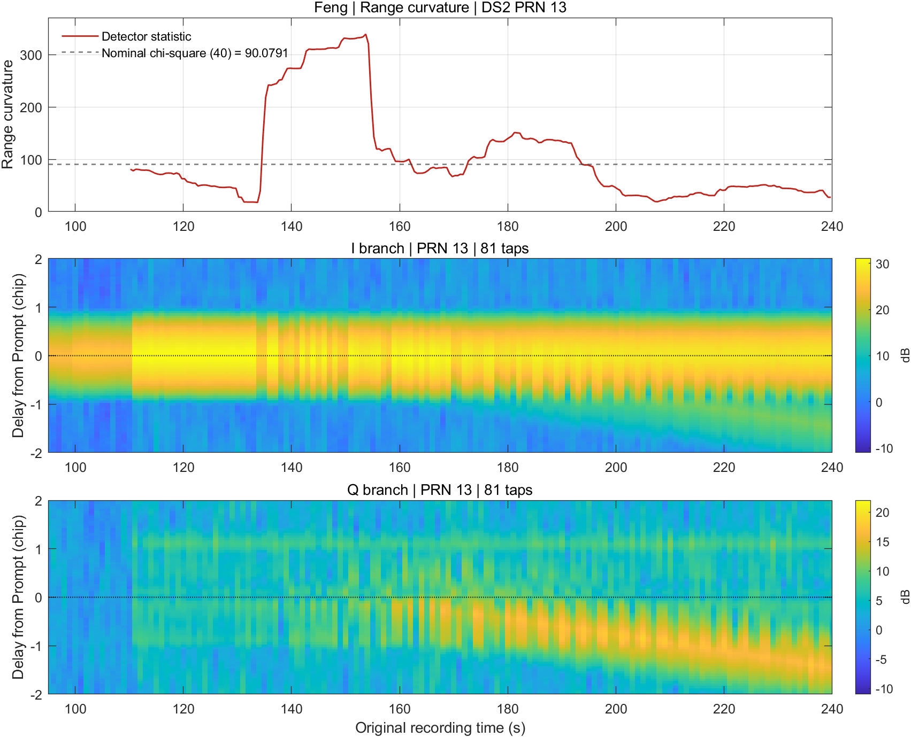

**图 11｜DS2 PRN 13。** 约 135 s 开始明显升高，约 194 s 后回到门限下；此时两条相关峰仍在分开。匀速拉走跟踪点可以让距离持续偏移，但每秒增加的距离差不多，二阶差分就会变小。

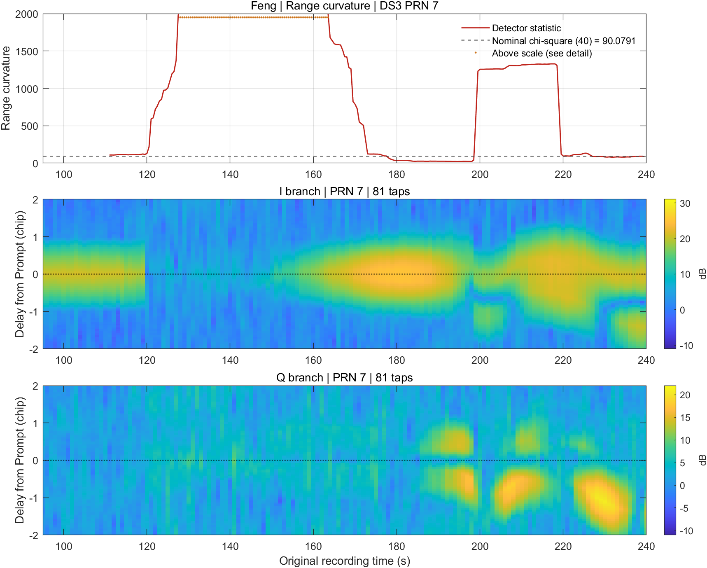

**图 12｜DS3 PRN 7（主图）。** 弱峰期间，接收机跟到的伪距变化很不平稳。到 128.515 s 为止的两个半秒内，伪距先减少约 238 米，接着减少约 128 米，变化量相差约 111 米。这个差分约占最高分的 18%，其余来自同一 20 秒窗内的其他波动。主图纵轴用 0–2000；[125–170 s 全幅详图](figures/detail_feng_ds3_prn07.png)保留约 145 s 的峰值 9116。

**为什么开头留白？** 接收机先要形成伪距，再凑够 40 个差分。DS2、DS3 分别在约 110.2 s 和 111.0 s 出第一个值，之后八组都连续出值。不同卫星的结果有差异：[DS2 PRN 32](figures/feng_ds2_prn32.png) 全段最高约 40，低于门限 90。

图 12 在约 199–219 s 还有一个平台。199 s 附近，相邻的三个半秒内，伪距依次减少约 155、89、157 米。中间一步突变又恢复，前后两个差分把检测量抬高；约 20 秒后它们滑出窗口，曲线随之回落。

**判断。** Feng 的单星越阈提示：**近 20 秒内，伪距变化的速度不稳。** 牵引起步或变速、跟踪读数突然跳动，都可能推高检测量。DS3 PRN 7 的高值就对应伪距读数的急变。原文用不少于半数可见星越阈给出共同告警。

如果伪距每秒偏移的量差不多，二阶差分仍会很小，检测量就可能回落。DS2 PRN 13 回到门限下方时，两条峰迹仍在分开；DS2 PRN 32 在展示区间内始终未越阈。因此，这个统计量更容易检出牵引速度变化或跟踪跳动，对平稳牵引的响应较弱。

## 第 5 章　Bhuiyan：前端采样电平的直方图

### 5.1 检测量

[Bhuiyan 等](https://link.springer.com/article/10.1007/s10291-026-02102-z) 在捕获前检查电平分布。令 $`k`$ 为 ADC 电平分箱的编号，$`O_k`$ 为观测窗落在第 $`k`$ 箱的样本数，$`C_k`$ 为参考样本落在同一箱的样本数。令 $`N=\sum_k O_k`$ 为当前窗的样本总数，$`j`$ 为遍历参考分箱的求和下标。将参考直方图缩放到总数 $`N`$ 后，得到第 $`k`$ 箱的期望频数 $`E_k`$，再计算 Pearson 检测量 $`X^2`$。

```math
E_k=N\frac{C_k}{\sum_j C_j},\qquad
X^2=\sum_{k:E_k>0}\frac{(O_k-E_k)^2}{E_k}.
```

若某一箱在参考里从未出现（$`E_k=0`$），观测却落入该箱（$`O_k>0`$），完整的 Pearson 统计量无定义。图中的 64 个合并箱均有正的参考频数，所有观测窗均可计算。

### 5.2 门限怎么算

1. DS2、DS3 各自从录制的 85、86、87、88、89 s 分别取首个 100 ms，合并 I、Q 样本。按从 0 到 1 等间隔的 65 个概率取分位数，去除重复边界，再把最外两端延伸至负无穷和正无穷。本次得到 64 个近似等频的箱，随后冻结箱边界和参考频数。
2. 在 85–98 s 的各整秒，用首个 100 ms 的 I 样本分别计算 $`X^2`$。共 14 个有效值，记为 $`\mathcal B_I`$；其中前五窗也参与了分箱。
3. 对 $`\mathcal B_I`$ 分别求经验第 99 百分位，记为 $`\widehat Q_{0.99}(\mathcal B_I)`$。以线性门限 $`\gamma_\mathrm{emp}`$ 判决，图上门限 $`\gamma_\mathrm{dB}`$ 和检测量同时换算为 dB。

```math
\gamma_\mathrm{emp}=\widehat Q_{0.99}(\mathcal B_I),
\qquad
\gamma_\mathrm{dB}=10\log_{10}(\gamma_\mathrm{emp}).
```

DS2 的门限是 539.53（27.32 dB），DS3 是 432.27（26.36 dB）。有效窗在 $`X^2>\gamma_\mathrm{emp}`$ 时越阈。

**原文公式与实现。** 式 (3)–(4) 写成采样值求和，式 (5) 则需要逐电平频数；实现按式 (5) 计数。式 (7) 中的互补误差函数反演参数写为 $`1-p`$。若 $`p`$ 表示名义上尾概率，$`\mu`$、$`\sigma`$ 分别表示高斯近似中基线检测量的均值和标准差，$`\mathrm{erfc}^{-1}`$ 为互补误差函数的反函数，则线性门限应为 $`\mu+\sqrt{2}\sigma\mathrm{erfc}^{-1}(2p)`$，再换算为 dB。实测图使用上面按合并分箱计算的经验门限。

### 5.3 实测结果：前端电平分布有没有变？

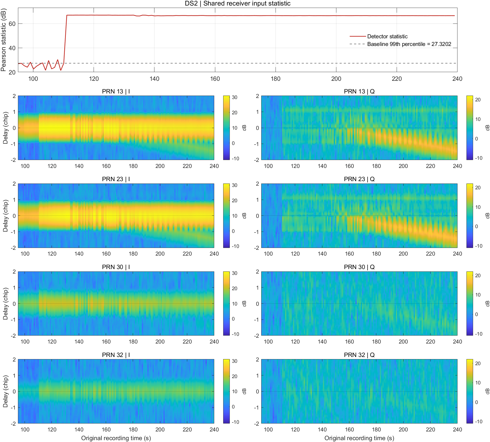

**图 13｜DS2。** 110.1–111.1 s，I 采样的均方根从约 602 升到 1116 个 ADC 计数，检测量从 27.2 升到 67.0 dB；此时各星峰迹还没有明显分开。

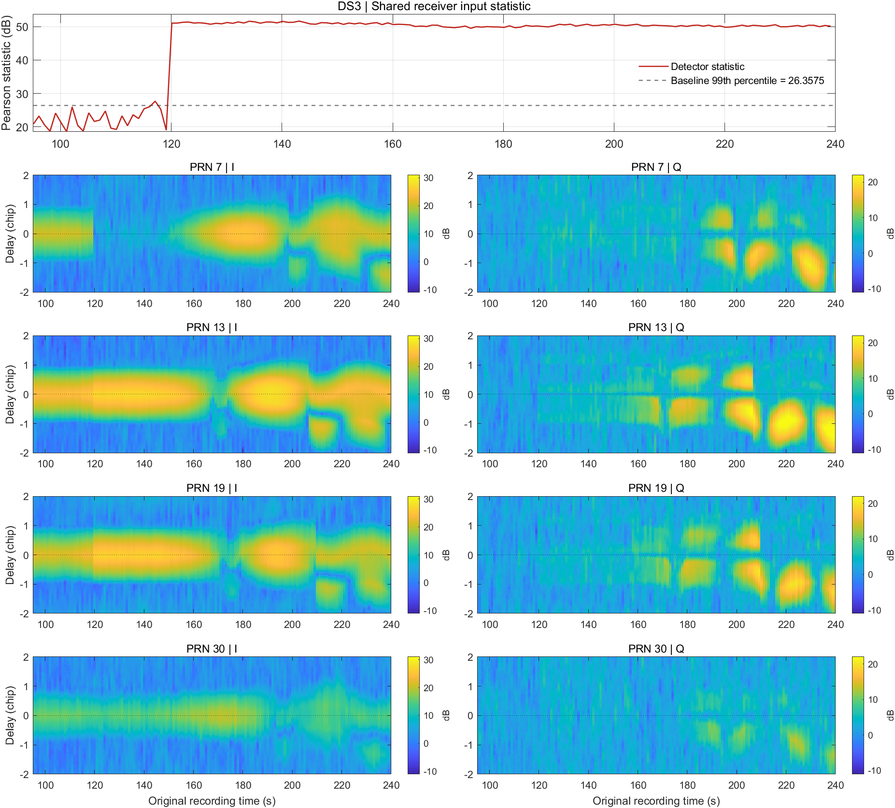

**图 14｜DS3。** 119.1–120.1 s，均方根从约 597 升到 691，检测量从 19.0 升到 51.0 dB。下方四颗星共用这个前端结果。

**原因定位。** 把两个跳变后的 100 ms 窗分别缩放到各自标定段的均方根，再用同一套箱子重算。DS2 从 67.0 降到 42.3 dB，DS3 从 51.0 降到 27.9 dB。去掉整体幅度差后，两次响应都明显减弱；DS2 仍有较大的剩余变化，说明其电平分布的变化不只表现为整体放大。逐 ADC 电平单独分箱时，参考里未出现过的电平没有期望频数；图中用 64 个合并箱，两段都可计算全部 145 个窗。

**判断。** Bhuiyan 的越阈提示：**捕获前的输入电平分布发生了变化。** 整体功率抬升或电平分布形状改变都可能触发告警。将两段采样分别缩放到各自的参考均方根后，统计量的跳变都明显减弱，说明功率抬升是这两次响应的重要来源。每段录制只有一个前端统计量，下方的逐星峰迹用于说明输入变化之后各星的表现。

这个方法适合发现有明显输入电平变化的场景。若牵引期间前端电平分布仍接近参考，统计量就可能不越阈；前端增益变化或干扰若改变了电平分布，也可能触发同样的告警。

## 同一时段，五种方法读到什么

以 DS3 的 PRN 7 弱峰阶段为例。约 120 s，Bhuiyan 给出整段输入电平变化的线索。看同一时段的 PRN 7：Shang 的统计量反映相关曲线偏离单峰模板，Deng 的高值主要来自四点 Q 相加后的波动，Feng 的高值对应伪距变化速度不稳。Sun 在 132 s 后出现的高台，事后可追溯到一个接近零的中心 I。运行时，各方法仍以自己的统计量和判决规则给出告警。

[MATLAB 文件与重绘说明](#运行与复现)

## 运行与复现

两种下载包对应本页同一版报告，均可在 MATLAB R2024b 中运行。两个 ZIP 均可在 [ds23-20261110 发布页](https://github.com/Doct0rLu/gnss-spoofing-ds2-ds3/releases/tag/ds23-20261110) 下载。

| 包 | 内容 | 适合谁 |
|---|---|---|
| [轻量重绘包](https://github.com/Doct0rLu/gnss-spoofing-ds2-ds3/releases/download/ds23-20261110/gnss-spoofing-ds23-report-kit-20261110.zip) | 五个检测模块、`figure_data.mat`、重绘脚本、报告和原图 | 想直接看图，或调整坐标、图例和排版 |
| [完整 MATLAB 源码包](https://github.com/Doct0rLu/gnss-spoofing-ds2-ds3/releases/download/ds23-20261110/gnss-spoofing-ds23-matlab-only-20261110.zip) | 从 IQ 读取、捕获、跟踪、多点相关到检测、标定与绘图的全链路；代码及配置均为 `.m` | 想查清每个量如何得到，或用同一批原始数据重新计算 |

**直接重绘。** 解压轻量包，把 MATLAB 当前目录切到包根目录，运行：

~~~matlab
render_figures
~~~

脚本读取随包提供的 `figure_data.mat`。PRN 7 的原因定位图（图 5）随包提供；其余 39 张图可直接重绘。

**从原始 IQ 重新计算。** 从 [TEXBAT 官方数据页](https://radionavlab.ae.utexas.edu/texbat/) 准备 `cleanStatic.bin`、`ds2.bin`、`ds3.bin`。在完整源码包（或本仓库）根目录运行，先把三个示例路径改成实际目录：

~~~matlab
rawRoot  = 'path/to/texbat';       % 官方完整录制
dataRoot = 'path/to/iq_clips';     % 保存三段 IQ 片段
workRoot = 'path/to/ds23_outputs'; % 保存接收机和报告结果

prepare_texbat_iq(rawRoot, dataRoot);
run_ds23('all', dataRoot, workRoot, 0, fullfile(rawRoot, 'cleanStatic.bin'));
~~~

[片段准备脚本](prepare_texbat_iq.m) 按原字节截取 cleanStatic 的 0–42 s 和 DS2、DS3 的 85–245 s，校验长度与 SHA-256。已有[匹配片段](spoof_receiver/matlab/ds23_iq_contract.m)时可跳过准备步骤。[运行入口](run_ds23.m) 的第四个参数 `0` 表示串行，第五个参数只用于重新绘制图上的真实峰辅助标注，可省略；统计量和门限不使用该参数。接收机和派生计算也可分开用 `'receiver'` 和 `'derive'` 两个阶段运行。

结果写入 `workRoot/report/`。若已有生成的绘图数据，可用 [render_figures.m](render_figures.m) 重绘：

~~~matlab
render_figures(fullfile(workRoot, 'report', 'figure_data.mat'))
~~~

图 5 的计算在 [PRN 7 诊断脚本](spoof_receiver/matlab/diagnose_ds23_prn7.m) 中。跟踪环使用早、准、迟三个基本相关点；图中的 81 个点由[多点相关代码](spoof_receiver/matlab/derive_ds23_star.m) 按各历元的载波和码相位从原始 IQ 离线补算。

五个检测模块：[Sun](sun_qsqm.m) · [Shang](shang_multicorrelator.m) · [Deng](deng_qcomposite.m) · [Feng](feng_cd2p.m) · [Bhuiyan](bhuiyan_if.m)。GPS L1 C/A 软件接收机基于 [CU-SDR-Collection](https://github.com/gnsscusdr/CU-SDR-Collection) 的提交 `0d506c7b3907113f9e371d9ff87be1aa83772917`，许可见 [LICENSE](LICENSE)。原始 IQ 由 TEXBAT 提供，发布包不包含这些录制。
